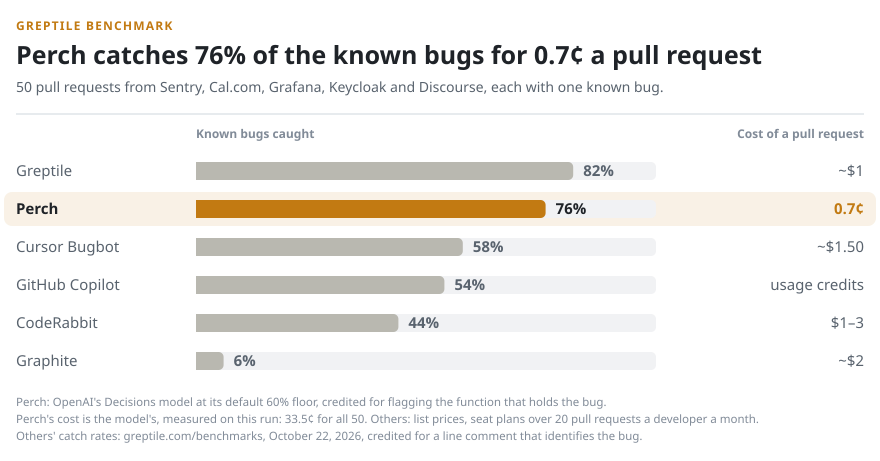
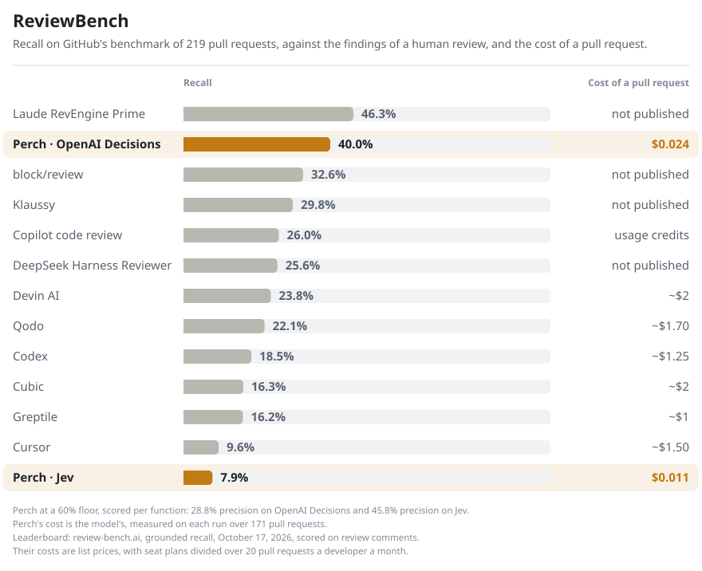

# Benchmarks

Perch on two public code review benchmarks, on OpenAI's Decisions model and on Jev, at a 60% floor. Perch's own floor for the bug questions is now 80% on Decisions and 60% on Jev. Perch is scored per
function: a bug counts as caught when perch flags the function that holds it. The other tools were scored on their review
comments.

## Greptile benchmark

<picture>
  <source media="(prefers-color-scheme: dark)" srcset="../.github/greptile-dark.svg">
  
</picture>

[Greptile's benchmark](https://www.greptile.com/benchmarks) puts 50 pull requests from Sentry, Cal.com, Grafana, Keycloak and
Discourse in front of each reviewer, each with one known bug.

| Reviewer | Known bugs caught | Cost of a pull request |
|---|---:|---:|
| Greptile | 82% | ~$1 |
| **Perch · OpenAI Decisions** | **76%** | **$0.007** |
| Cursor Bugbot | 58% | ~$1.50 |
| GitHub Copilot | 54% | usage credits |
| CodeRabbit | 44% | $1–3 |
| **Perch · Jev** | **44%** | **$0.003** |
| Graphite | 6% | ~$2 |

At an 80% floor perch catches 56% on OpenAI. Perch's cost is the model's, measured on each run: $0.34 on OpenAI and $0.15 on Jev for all 50 pull requests. The other
tools' catch rates are Greptile's, read on October 22, 2026, and their costs are list prices: seat plans divided over 20 pull
requests a developer a month. Bugbot comes with Cursor's Teams plan at $30 a seat.

## ReviewBench

<picture>
  <source media="(prefers-color-scheme: dark)" srcset="../.github/reviewbench-dark.svg">
  
</picture>

[ReviewBench](https://review-bench.ai) is GitHub's benchmark: 219 pull requests with the findings of a human review.

| | Recall | Precision | Cost of a pull request |
|---|---:|---:|---:|
| **Perch · OpenAI Decisions** | **40.0%** | **28.8%** | **$0.024** |
| **Perch · Jev** | **7.9%** | **45.8%** | **$0.011** |
| Perch · OpenAI Decisions at 80% | 23.2% | 41.7% | $0.024 |

Laude RevEngine Prime leads the leaderboard at 46.3% recall, and perch on OpenAI is second. Perch read 171 of the pull requests;
the other 48 changed no function it reads or sit in repositories that no longer exist. The leaderboard's numbers are
review-bench.ai's, read on October 17, 2026.

## Runs and data

[`greptile/`](greptile) and [`reviewbench/`](reviewbench) hold the scripts that score each run and draw the charts. The runs, their answers and the labels are in the
[perchscan/benchmark-results](https://huggingface.co/datasets/perchscan/benchmark-results) dataset on Hugging Face.
